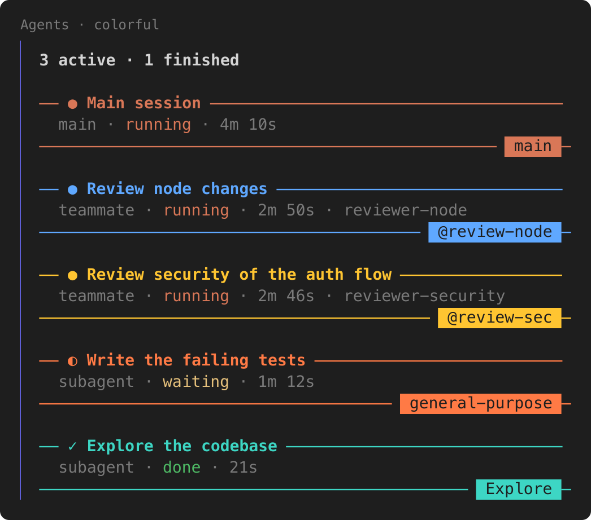
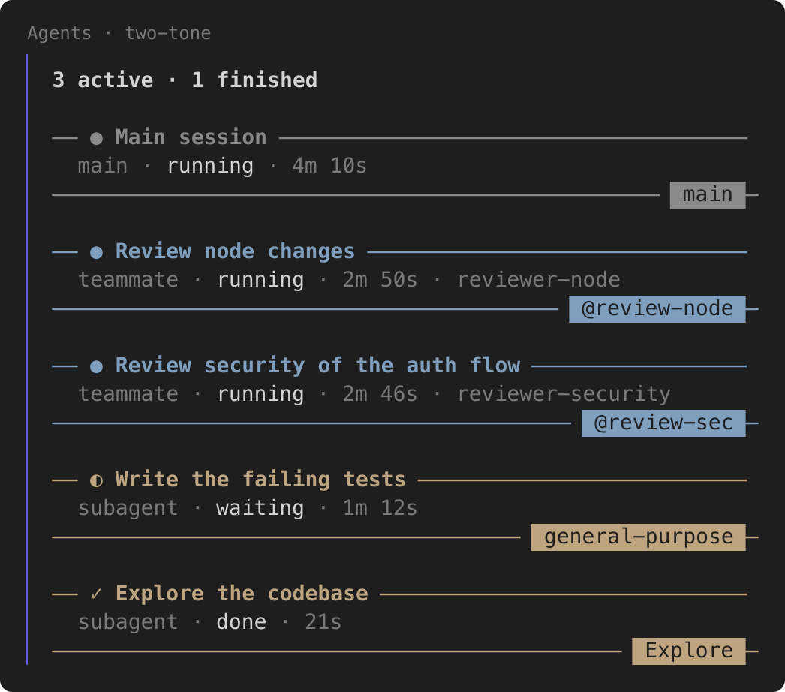

# agent-sidebar

A Claude Code mod that gives your **subagents and teammates** a side pane of their own, drawn in the style of **tmux**.

When you run several agents at once, the transcript gets crowded and it is hard to tell who is doing what. `agent-sidebar` opens a pane beside the chat with one colored card per agent, separated by rules and labeled with a tag on the right, the same way tmux frames its panes:

| `colorful` (default) | `two-tone` |
| --- | --- |
|  |  |

<sub>Rendered previews of the pane's layout and colors.</sub>

## Features

### A card for every agent
- **The main session** on top, always in the same color, with its status, turn time and the session's total cost.
- **One card per agent**, in a color that stays the same for the whole session.
- **Kind** of agent: `teammate` or `subagent`.
- **Status** at a glance: queued, running, waiting, idle, done, failed, stopped.
- **Elapsed time**, ticking only while the agent works.
- **The tag** on the closing rule: `@name` for teammates, the agent type for subagents.
- **Nested agents** marked with `↳`.
- Active agents first, then finished ones, most recent first.
- **Click a card's title** to jump to that agent's transcript; the main card takes you back.

### Tokens and cost
- **Tokens and estimated cost** on every card: `8.2k tok · ~$0.31`.
- **The session total** on the main card: `~$1.84 total`.
- They stay on the card after the agent is gone.
- In a narrow pane the line is cut at its end, so tokens and cost come before the agent type.
- The cost is **Claude Code's own estimate**, the same figure as `/cost`. On a subscription it is not what you pay.
- The tokens are Claude Code's own count: the latest request's input plus all the output so far.

### System notifications
- A notification when an agent **finishes or fails**, so you can look away while agents work.
- Stopped agents send none, and each agent sends one at most.
- Turn them off with the `notifications` option.

### More room for the chat
- **Hides Claude Code's own agent list** under the prompt: the pane shows the same agents.

## Install

At the prompt of a Claude Code terminal session:

```
/plugin install agent-sidebar --marketplace shaasa/agent-sidebar
```

Answer `y` to add the marketplace, then pick a scope (user scope is the default).

From a shell:

```
claude plugin install agent-sidebar --marketplace shaasa/agent-sidebar
```

In the desktop app, where `/plugin` does not run: click **+** next to the prompt box, then **Plugins**, **Add marketplace** with `shaasa/agent-sidebar`, then **Add plugin**.

## Use

- The pane **opens by itself** when the first agent starts, if the terminal is wide enough to dock it beside the chat.
- Open it any time with:

```
/agent-sidebar
```

## Options

Set them when you install, later in `/config`, or with:

```
/plugin configure agent-sidebar@agent-sidebar
```

| Option | Values | Default |
| --- | --- | --- |
| `palette` | `colorful`, `two-tone` | `colorful` |
| `notifications` | `true`, `false` | `true` |

### Palette

| Value | Look |
| --- | --- |
| `colorful` | Every agent gets its own color; the main session is always Claude orange. |
| `two-tone` | Only two muted colors: blue-gray for **teammates**, sand for **subagents**. The main session is always **gray**, and status words are plain. |

### Notifications

Sent through the notification channel set in Claude Code: iTerm2, kitty, Ghostty, or the terminal bell. If no channel is set, nothing is sent and the pane still shows the change.

## Update

At the prompt, run `/plugin`, pick `agent-sidebar` and choose **update**. The running session reloads the mod, no restart needed.

From a shell (applies to sessions started afterwards):

```
claude plugin marketplace update agent-sidebar
claude plugin update agent-sidebar@agent-sidebar
```

## Develop

```
claude --plugin-dir ./agent-sidebar   # run a session with the mod loaded from this folder
claude plugin validate .              # check the manifest and the hooks module
claude plugin test .                  # run the tests in tests/
```

## License

MIT
